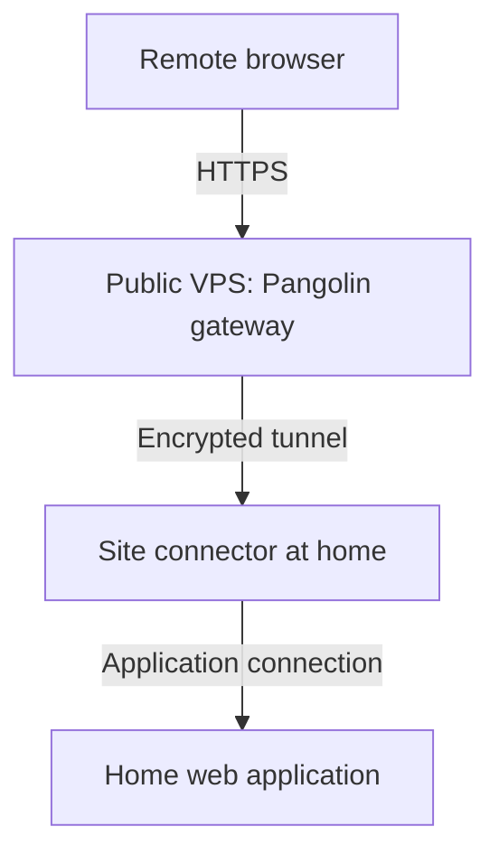

# How to expose your Home Lab to the Internet

This guide was written for popular ISPs in India not local ISPs. If you are using a local ISP try speaking to the
tech team, they might be able to customize to your requirements.

!!! info
    Decide what you want to expose first. If your use case is just HTTP or remote access any of the following methods could work for you. This guide was written with the following services in mind:

    - TCP/UDP
    - Torrenting (i.e being connectable with your torrent tracker aka port forwarding)
    - Public Access Website (i.e without installing software on client machines)

---

## Static IP

Supports: Everything

By far this is the easiest way to expose your homelab because you don't have to deal with the other challenges that arise with the other methods.

Pros:

- Very stable.
- Easy to diagnose network issues.
- No additional network hops like with ZeroTier.
- Can be used with private torrents.
- Can use your static IP as a whitelist for cloud services.

Cons:

- Pricing can range from ₹299-499 a month, which could have been used to get a VPS instead.

## IPv6

Supports: HTTP/s, TCP/UDP, Public Access Website

This should work with almost any ISP in India but you need to configure DDNS which could result in a **downtime** of 5mins
when the IP prefix changes.

MANY private torrent trackers DO NOT support IPv6 and there are VERY little IPv6 peers.

In OpenWRT you can use the DDNS package and use a script to ONLY update the prefix of the IPv6, you do not need to
run DDNS software on every IPv6 host. SLAAC, DHCP reservation or IPv6 tokens can be used for static suffixes.

Pros:

- High speed without additional hops
- Direct p2p connection without additional hops or NAT.

Cons:

- DNS propogation time.
- Clients NEED to support IPv6. Many businesses, schools and colleges DO NOT have IPv6.
- Downtime of 5mins when IP prefix changes. OpenWRT DDNS supports only 5mins DNS updates.

## Cloudflare Tunnels

Supports: NEED RESEARCH, PRs are welcome

Pros:

- Easiest way to host websites on CG-NAT.
- Automatic TLS certificates.

Cons:

- Does not support every protocol.
- Additional network latency.
- Depends on availability of Cloudflare.
- Cloudflare CAN read traffic if not using HTTPs.

## Selfhosted VPN

Supports: Everything

This category is when your run any kind of VPN software on a VPS like WireGuard, Pangolin, etc.

DO NOT ASSIGN VPN IPs to your home LAN, you will get blocked from many websites because you are using a hosting IP.
Create a subnet for your servers and assign VPN IPs there.

We recommend getting Linode because it gives you free /48 IPv6 prefix but you can get any other provider from LowEndBox also.

Pros:

- Can get proper static IPv6 and IPv4.
- Can assign separate IPv6 /64 prefix to VLANs.
- Can run lightweight services in the Cloud itself for higher uptime.

Cons:

- Additional network latency.
- Bandwidth could be limited.
- Additional cost and management of VPS.

### Pangolin behind CGNAT

*By techno*

A home server can work perfectly on the LAN and still be difficult to reach from outside. With carrier-grade NAT (CGNAT), the ISP shares public IPv4 connectivity between customers, so a port-forwarding rule on the home router alone cannot provide an inbound path.

Pangolin provides another route: a gateway on a VPS with a public IP, connected to your home network through a site connector. I use OCI-hosted Pangolin gateways and Newt connectors in my own homelab, including a public Plex route and private access to selected resources.

This guide explains that arrangement, the hosting choices and the lessons from using it. The setup links below lead to the official instructions for the actual installation and configuration.

#### How the connection works

The connector initiates the connection from home. The gateway forwards authorised requests through that connection to the selected application; the application's port does not need forwarding on the home router. For public HTTP/HTTPS resources, visitors use an ordinary browser without a Pangolin client. [Official HTTP/HTTPS resource guide](https://docs.pangolin.net/manage/resources/public/http-https)

There are two useful access patterns:

| Pattern | How the user connects | Example |
| --- | --- | --- |
| Public HTTP/HTTPS resource | A hostname in a browser, with Pangolin authentication available | Sharing a web application with authorised users |
| Private resource | An authorised device running a Pangolin client | Reaching selected internal hosts and services |

“Public” describes the resource's internet-facing entry point; it can still require login. Publishing an application also does not require routing the home's general internet browsing through the VPS. [Public resource authentication](https://docs.pangolin.net/manage/resources/public/authentication)

The VPS becomes part of the system you trust. For the public web route shown above, browser HTTPS terminates at the gateway, which handles the request before forwarding it through the site tunnel. Private clients can establish a direct encrypted connection to the site, with an encrypted relay path when a direct connection is unavailable. [Pangolin architecture and traffic paths](https://docs.pangolin.net/development/system-architecture)

#### Choosing a VPS

For OCI Always Free setup, discounted India-hosted VPS options and purchasing checks, see [Finding an affordable VPS](../../hardware/vps.md#finding-an-affordable-vps).

#### Follow the official setup guides

Have a domain you control, a supported Linux VPS and an always-on home machine that can reach your application. Work through the following sequence, starting with a single web application.

1. **Prepare the server.** Follow [Docker's Ubuntu installation guide](https://docs.docker.com/engine/install/ubuntu/) if using Ubuntu. Read its firewall section: Docker-published ports can bypass UFW/firewalld rules. Use the cloud firewall as well and retain access to the provider's console.

2. **Configure DNS and networking.** Follow [Pangolin's DNS and networking guide](https://docs.pangolin.net/self-host/dns-and-networking). It explains the gateway's DNS records, ports and tunnel subnet considerations. Apply the required rules to the cloud network and host. The home application's port does not need opening on the VPS.

3. **Install the gateway.** Use the [Community Edition quick installation guide](https://docs.pangolin.net/self-host/quick-install). Let its installer generate the matching gateway components. Complete administrator setup, enable [MFA](https://docs.pangolin.net/manage/access-control/mfa) and resolve certificate errors before continuing.

4. **Connect the home site.** Follow the [official site installation guide](https://docs.pangolin.net/manage/sites/install-site), including its persistent service or container instructions. The Pangolin CLI is currently recommended for new sites. My deployment uses standalone Newt; the separate [Newt guide](https://docs.pangolin.net/manage/sites/install-newt) covers that supported option. Keep site credentials private.

5. **Publish one protected application.** Use the [HTTP/HTTPS resource guide](https://docs.pangolin.net/manage/resources/public/http-https), [target configuration](https://docs.pangolin.net/manage/resources/public/targets) and [authentication settings](https://docs.pangolin.net/manage/resources/public/authentication). Choose the correct site and an application address reachable from that connector. Keep Pangolin login enabled and assign access to the intended users or roles.

6. **Add private access if needed.** Follow the [private host resource guide](https://docs.pangolin.net/manage/resources/private/host) and [client installation instructions](https://docs.pangolin.net/manage/clients/platforms). Start with one host and restrict its allowed ports; private host resources otherwise allow all TCP and UDP ports by default.

Use the commands and configuration supplied by those guides for your installed release. This avoids mixing a current gateway installer with an independently copied connector configuration.

#### What mattered in my own setup

**An online connector is only the first check.** Different connectors in my setup did not have identical access to every backend. A site showing as online did not prove it could reach the chosen application. Check the destination from the selected connector's network; success from its host alone may not establish reachability from a container. Inside a container, `localhost` refers to that container.

**Browser access and native clients need separate testing.** My Plex route retained Plex's own authentication. An additional browser login in front of an application's API can interrupt native clients. That choice depends on the application and its authentication; an application without its own login still needs protection. Test the normal client workflow as well as the web page.

**Public and private access are separate paths.** A working public application route does not establish that a laptop's private connection reaches the intended destinations. Test each path you plan to use, and keep direct LAN access independent of the remote gateway.

A second gateway also needs its own configuration and recovery plan. Having two gateways does not by itself establish automatic failover between them.

#### Check access from outside the home network

Use mobile data or another external connection to confirm:

- The hostname resolves correctly and presents a trusted certificate.
- A signed-out visitor must authenticate to the protected web application.
- An authorised user can use the application, while a user without permission is denied.
- Any private resource is reachable only through the intended authorised client and access rules.
- Direct LAN access continues working independently.

For media applications, test actual playback. A successful HTTP response from an identity or status endpoint does not prove that library access and streaming work correctly. Performance also depends on home upload speed, the VPS route and congestion.

#### Keeping the gateway maintainable

Retain an encrypted backup of the configuration and persistent state, with credentials kept out of public repositories and screenshots. Test restoration before relying on that backup for recovery. Cheap hosting is most useful when you can recover from losing the instance.

Before changing versions, read the [official update and migration instructions](https://docs.pangolin.net/self-host/how-to-update), retain a matching backup and preserve a working access path until its replacement has been checked externally.

*AI assistance was used for drafting, formatting and sentence structure. The homelab deployment experience and practical observations are my own.*

## Commercial VPNs

Supports: Everything

VPNs like ZeroTier, TailScale come into this category, it uses UDP hole punching to achieve direct p2p connection via an intermediate server. If that fails it uses its relay server.
This is often the best method to access administrative tools because its secure and not exposed to the Internet directly.

Pros:

- Easy and secure method to access your home network even behind CG-NAT.

Cons:

- Speeds could be unreliable sometimes due to UDP hole punching.
- Will always get slower speeds than WireGuard hosted on a Static IP.

## Dynamic Public IPv4

Rare in India but if your router gets a public IP, you can just use DDNS. Of course this has the same 5mins DNS update
time disadvantage of IPv6 DDNS.

