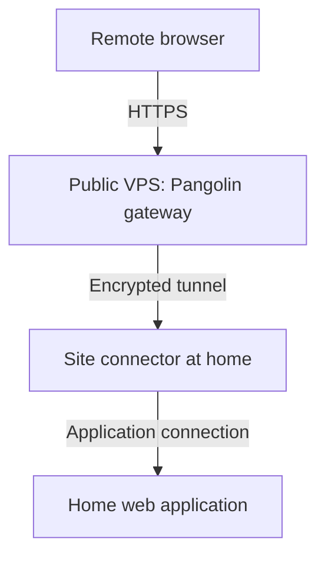

# Accessing your homelab behind CGNAT with Pangolin

*By techno*

A home server can work perfectly on the LAN and still be difficult to reach from outside. With carrier-grade NAT (CGNAT), the ISP shares public IPv4 connectivity between customers, so a port-forwarding rule on the home router alone cannot provide an inbound path.

Pangolin provides another route: a gateway on a VPS with a public IP, connected to your home network through a site connector. I use OCI-hosted Pangolin gateways and Newt connectors in my own homelab, including a public Plex route and private access to selected resources.

This article explains that arrangement, the hosting choices and the lessons from using it. The setup links below lead to the official instructions for the actual installation and configuration.

For a comparison with static IPs, IPv6, Cloudflare Tunnel and other approaches, start with [How to expose your Home Lab to the Internet](exposing.md).

## How the connection works

The connector initiates the connection from home. The gateway forwards authorised requests through that connection to the selected application; the application's port does not need forwarding on the home router. For public HTTP/HTTPS resources, visitors use an ordinary browser without a Pangolin client. [Official HTTP/HTTPS resource guide](https://docs.pangolin.net/manage/resources/public/http-https)

There are two useful access patterns:

| Pattern | How the user connects | Example |
| --- | --- | --- |
| Public HTTP/HTTPS resource | A hostname in a browser, with Pangolin authentication available | Sharing a web application with authorised users |
| Private resource | An authorised device running a Pangolin client | Reaching selected internal hosts and services |

“Public” describes the resource's internet-facing entry point; it can still require login. Publishing an application also does not require routing the home's general internet browsing through the VPS. [Public resource authentication](https://docs.pangolin.net/manage/resources/public/authentication)

The VPS becomes part of the system you trust. For the public web route shown above, browser HTTPS terminates at the gateway, which handles the request before forwarding it through the site tunnel. Private clients can establish a direct encrypted connection to the site, with an encrypted relay path when a direct connection is unavailable. [Pangolin architecture and traffic paths](https://docs.pangolin.net/development/system-architecture)

## Finding an affordable VPS

Look for a public IP, support for the required tunnel traffic and a good route to your home and users. CPU and RAM matter, but so do transfer limits and the provider's recovery tools. Start with [Pangolin's VPS selection guidance](https://docs.pangolin.net/self-host/choosing-a-vps) for sizing and requirements.

### OCI Always Free

OCI can keep the gateway's hosting cost at **US$0 within the applicable free allowances**. Domain registration and any chargeable resources are separate expenses. Free compute capacity is not guaranteed.

Use these official guides in order:

1. **[Register for Oracle Cloud](https://docs.oracle.com/en-us/iaas/Content/GSG/Tasks/signingup_topic-Sign_Up_for_Free_Oracle_Cloud_Promotion.htm).** Choose the home region carefully because it cannot be changed later. Check whether Mumbai or Hyderabad is offered and suitable. Signup includes payment verification; a temporary card hold may appear.
2. **[Check Always Free eligibility and limits](https://docs.oracle.com/en-us/iaas/Content/FreeTier/freetier_topic-Always_Free_Resources.htm).** Verify the compute shape, memory, boot volume and transfer allowances against your existing usage. Trial credit and Always Free are different; a resource covered by trial credit may become chargeable later.
3. **[Create and connect to a Linux instance](https://docs.oracle.com/en-us/iaas/Content/Compute/tutorials/first-linux-instance/overview.htm).** Use an eligible image and shape, with a public IP and working internet routing. The tutorial explains networking and SSH access; select resources within your free allowance.

If capacity is unavailable, waiting or trying another offered availability domain may help. A paid upgrade does not guarantee free capacity. Review the [upgrade terms](https://docs.oracle.com/en-us/iaas/Content/FreeTier/freetier.htm) before changing account type. On a paid account, [budget alerts](https://docs.oracle.com/en-us/iaas/Content/Billing/Concepts/budgetsoverview.htm) provide notifications rather than a hard spending cap.

### Discounted VPS hosting in India

The forum usually shortened to **LET** is [LowEndTalk](https://lowendtalk.com/categories/offers). [LowEndBox](https://lowendbox.com/) is a related deals site. Black Friday and Cyber Monday are useful times to look for annual offers.

**Around US$20–30 per year is a sale-shopping target**, subject to stock, exchange rates and additional charges. As an example, an early Black Friday offer checked on **4 November 2026** advertised a Mumbai VPS at **€21/year**, with 2 vCPUs, 4 GB RAM and 40 GB NVMe storage. This is a dated provider advertisement, not a reliability recommendation. [Original offer and terms](https://lowendtalk.com/discussion/222164/early-black-friday-sale-vps-dedicated-server-deals-starting-at-just-18-year)

Check the actual server location, public IPv4 inclusion, permitted Docker/UDP use, renewal price, taxes, transfer accounting and recovery console. Read independent customer reports as well as the offer. An Indian provider can also sell servers located overseas.

Transfer accounting deserves particular attention for a gateway. If a provider counts both incoming and outgoing traffic, relaying 10 GB through the VPS can consume roughly 20 GB of its allowance, before overhead. Confirm the provider's definition, overage policy and final checkout total before ordering.

## Follow the official setup guides

Have a domain you control, a supported Linux VPS and an always-on home machine that can reach your application. Work through the following sequence, starting with a single web application.

1. **Prepare the server.** Follow [Docker's Ubuntu installation guide](https://docs.docker.com/engine/install/ubuntu/) if using Ubuntu. Read its firewall section: Docker-published ports can bypass UFW/firewalld rules. Use the cloud firewall as well and retain access to the provider's console.

2. **Configure DNS and networking.** Follow [Pangolin's DNS and networking guide](https://docs.pangolin.net/self-host/dns-and-networking). It explains the gateway's DNS records, ports and tunnel subnet considerations. Apply the required rules to the cloud network and host. The home application's port does not need opening on the VPS.

3. **Install the gateway.** Use the [Community Edition quick installation guide](https://docs.pangolin.net/self-host/quick-install). Let its installer generate the matching gateway components. Complete administrator setup, enable [MFA](https://docs.pangolin.net/manage/access-control/mfa) and resolve certificate errors before continuing.

4. **Connect the home site.** Follow the [official site installation guide](https://docs.pangolin.net/manage/sites/install-site), including its persistent service or container instructions. The Pangolin CLI is currently recommended for new sites. My deployment uses standalone Newt; the separate [Newt guide](https://docs.pangolin.net/manage/sites/install-newt) covers that supported option. Keep site credentials private.

5. **Publish one protected application.** Use the [HTTP/HTTPS resource guide](https://docs.pangolin.net/manage/resources/public/http-https), [target configuration](https://docs.pangolin.net/manage/resources/public/targets) and [authentication settings](https://docs.pangolin.net/manage/resources/public/authentication). Choose the correct site and an application address reachable from that connector. Keep Pangolin login enabled and assign access to the intended users or roles.

6. **Add private access if needed.** Follow the [private host resource guide](https://docs.pangolin.net/manage/resources/private/host) and [client installation instructions](https://docs.pangolin.net/manage/clients/platforms). Start with one host and restrict its allowed ports; private host resources otherwise allow all TCP and UDP ports by default.

Use the commands and configuration supplied by those guides for your installed release. This avoids mixing a current gateway installer with an independently copied connector configuration.

## What mattered in my own setup

**An online connector is only the first check.** Different connectors in my setup did not have identical access to every backend. A site showing as online did not prove it could reach the chosen application. Check the destination from the selected connector's network; success from its host alone may not establish reachability from a container. Inside a container, `localhost` refers to that container.

**Browser access and native clients need separate testing.** My Plex route retained Plex's own authentication. An additional browser login in front of an application's API can interrupt native clients. That choice depends on the application and its authentication; an application without its own login still needs protection. Test the normal client workflow as well as the web page.

**Public and private access are separate paths.** A working public application route does not establish that a laptop's private connection reaches the intended destinations. Test each path you plan to use, and keep direct LAN access independent of the remote gateway.

A second gateway also needs its own configuration and recovery plan. Having two gateways does not by itself establish automatic failover between them.

## Check access from outside the home network

Use mobile data or another external connection to confirm:

- The hostname resolves correctly and presents a trusted certificate.
- A signed-out visitor must authenticate to the protected web application.
- An authorised user can use the application, while a user without permission is denied.
- Any private resource is reachable only through the intended authorised client and access rules.
- Direct LAN access continues working independently.

For media applications, test actual playback. A successful HTTP response from an identity or status endpoint does not prove that library access and streaming work correctly. Performance also depends on home upload speed, the VPS route and congestion.

## Keeping the gateway maintainable

Retain an encrypted backup of the configuration and persistent state, with credentials kept out of public repositories and screenshots. Test restoration before relying on that backup for recovery. Cheap hosting is most useful when you can recover from losing the instance.

Before changing versions, read the [official update and migration instructions](https://docs.pangolin.net/self-host/how-to-update), retain a matching backup and preserve a working access path until its replacement has been checked externally.

*AI assistance was used for drafting, formatting and sentence structure. The homelab deployment experience and practical observations are my own.*

